# دارایی‌های گرافیکی متحرک MES برای GitHub
# MES Animated GitHub Assets

این پوشه شامل مجموعه‌ای از دارایی‌های گرافیکی اختصاصی **معمار الکترونیک صنعت (MES)** است که برای نمایش هویت بصری مجموعه در مخازن GitHub، فایل‌های README، مستندات فنی و صفحات معرفی پروژه‌ها طراحی شده‌اند.

در این نسخه، دو اندازه از لوگوی متحرک MES ارائه شده است. هر دو فایل از یک هویت بصری مشترک با پس‌زمینه سرمه‌ای تیره، جلوه‌های نورانی آبی کبالت و فیروزه‌ای و حرکت پالس‌ها و گره‌های سیگنال روی مسیرهای شبیه به خطوط مدار چاپی (PCB) استفاده می‌کنند.

**هدف:** فراهم‌کردن دو اندازه کاربردی از لوگوی متحرک برای استفاده در بخش‌های مختلف مستندات و معرفی پروژه‌های MES.

This directory contains original **Memar Electronic Sanat (MES)** visual assets for GitHub repositories, README files, technical documentation, and project presentation pages.

Two sizes of the MES animated logo are provided. Both share the same visual identity: a deep navy background, cobalt-blue and cyan lighting, and animated signal pulses and nodes travelling along PCB-inspired tracks.

**Purpose:** To provide two practical logo sizes for use throughout MES repositories and project documentation.

---

## پیش‌نمایش لوگوها | Animated Logo Previews

### ۱. لوگوی متحرک – اندازه 1313 × 1198

این نسخه با ابعاد بزرگ‌تر و نسبت تصویر نزدیک به مربع، برای نمایش شاخص لوگو در صفحات معرفی، مستندات و بخش‌های گرافیکی README مناسب است.

This larger, near-square version is suitable for prominent logo presentation, project documentation, and visual sections of README files.

  

- [مشاهده فایل SVG](MES_Animated_Logo_1313x1198.svg)
- [View SVG source](MES_Animated_Logo_1313x1198.svg)

### ۲. لوگوی متحرک – اندازه 640 × 480

این نسخه با ابعاد خروجی کوچک‌تر، برای سربرگ README، معرفی کوتاه پروژه و محل‌هایی که فضای نمایش محدودتری دارند مناسب است.

This compact 640 × 480 version is suitable for README headers, project introductions, and layouts with more limited display space.

  

- [مشاهده فایل SVG](MES_Animated_Logo_640x480.svg)
- [View SVG source](MES_Animated_Logo_640x480.svg)

---

## مقایسه و کاربرد فایل‌ها | File Comparison and Use Cases

| فایل | ابعاد خروجی | کاربرد پیشنهادی |
|---|---:|---|
| [MES_Animated_Logo_1313x1198.svg](MES_Animated_Logo_1313x1198.svg) | 1313 × 1198 | نمایش بزرگ لوگو، صفحات معرفی و مستندات |
| [MES_Animated_Logo_640x480.svg](MES_Animated_Logo_640x480.svg) | 640 × 480 | سربرگ README و معرفی فشرده پروژه |

| File | Output Size | Recommended Use |
|---|---:|---|
| [MES_Animated_Logo_1313x1198.svg](MES_Animated_Logo_1313x1198.svg) | 1313 × 1198 | Large logo display, project pages, and documentation |
| [MES_Animated_Logo_640x480.svg](MES_Animated_Logo_640x480.svg) | 640 × 480 | README headers and compact project introductions |

---

## راهنمای استفاده در README | How to Embed in a README

از آنجا که این فایل راهنما در همان پوشه فایل‌های SVG قرار دارد، در نمونه‌های زیر مسیر تصاویر مستقیماً نام فایل است.

اگر می‌خواهید لوگو را در README واقع در ریشه مخزن نمایش دهید، مسیر کامل نسبی آن به شکل زیر خواهد بود:

Since this README is stored in the same directory as the SVG files, the examples below use the filenames directly.

To display a logo in a README located at the repository root, use the following relative path:

`Images/GitHub-Assets/`

### نمایش نسخه بزرگ | Large Logo

~~~html

  

~~~

### نمایش نسخه فشرده | Compact Logo

~~~html

  

~~~

### نمایش لوگو با عرض کامل | Full-width Logo

~~~html

  

~~~

**نکته مسیر:** اگر README در پوشه دیگری قرار دارد، مسیر نسبی فایل SVG را متناسب با محل README اصلاح کنید. همچنین مقدار `width` را می‌توانید برای تنظیم اندازه نمایش تغییر دهید.

**Path note:** If your README is stored in another directory, adjust the relative SVG path accordingly. You can also change the `width` value to control the displayed size.

---

## ویژگی‌های فنی و انیمیشن | Technical and Animation Features

- فرمت هر دو فایل **SVG** است.
- انیمیشن‌ها با قابلیت‌های استاندارد **SVG/SMIL** پیاده‌سازی شده‌اند.
- حرکت پالس‌های نوری روی مسیرهای مدار، جابه‌جایی گره‌های سیگنال، چرخش جزئیات مداری و تغییر شدت نور گره‌ها در انیمیشن استفاده شده است.
- تصویر پایه لوگو به‌صورت داده تصویری درون فایل SVG قرار گرفته است؛ بنابراین برای نمایش تصویر پایه به فایل تصویری جداگانه نیاز نیست.
- برای درج در README از تگ HTML یعنی `` استفاده کنید.
- نمایش انیمیشن SVG ممکن است با توجه به مرورگر، محیط نمایش و نحوه پردازش SVG در GitHub متفاوت باشد.

- Both assets use the **SVG** format.
- Animation is implemented with standard **SVG/SMIL** features.
- Animated effects include light pulses travelling along circuit tracks, moving signal nodes, rotating orbital details, and pulsing circuit points.
- The base logo artwork is embedded inside each SVG file; no separate image file is required for the base artwork.
- Use the HTML `` tag to embed the logo in a README.
- Animated SVG rendering may vary depending on the browser, viewing environment, and GitHub's SVG processing behavior.

---

## تصاویر و دیاگرام‌های راهنما | Reference Graphics

دو نسخه لوگوی متحرک MES برای انتخاب اندازه متناسب با چیدمان مستندات:

Two MES animated logo variants are available to match different documentation layouts:

<table>
  <tr>
    <td align="center">
       
      <strong>1313 × 1198 — Large</strong>
    </td>
    <td align="center">
       
      <strong>640 × 480 — Compact</strong>
    </td>
  </tr>
</table>

---

## تهیه و تدوین | Credits

**معمار الکترونیک صنعت | MEMAR ELECTRONIC SANAT (MES)**  
همراه شما در مسیر طراحی و ساخت مدارهای مطمئن

- [گیت‌هاب | GitHub](https://github.com/MEMAR-ELECTRONIC-SANAT)
- [تلگرام | Telegram](https://t.me/Memar_Electronic)
- [اینستاگرام | Instagram](https://www.instagram.com/Memar.Electronic)

[مشاهده سایر آموزش‌ها و پروژه‌ها در GitHub](https://github.com/MEMAR-ELECTRONIC-SANAT)

**Memar Electronic Sanat (MES)**  
*Your partner in designing and building reliable circuits.*

- [GitHub](https://github.com/MEMAR-ELECTRONIC-SANAT)
- [Telegram](https://t.me/Memar_Electronic)
- [Instagram](https://www.instagram.com/Memar.Electronic)

[Explore more tutorials and projects on GitHub](https://github.com/MEMAR-ELECTRONIC-SANAT)
