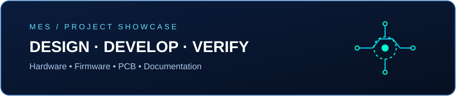

# دارایی‌های گرافیکی متحرک MES برای GitHub
# MES Animated GitHub Assets

مجموعه‌ای از فایل‌های گرافیکی **SVG متحرک** با هویت بصری اختصاصی **معمار الکترونیک صنعت (MES)** برای استفاده در فایل‌های README، مستندات پروژه‌ها و پروفایل GitHub.

این طرح‌ها با الهام از زبان بصری نئونی و مدارمحور پروژه [ElectroIoT](https://github.com/ElectroIoT/ElectroIoT) توسعه یافته‌اند؛ فایل‌های موجود در این مجموعه، طراحی اختصاصی MES هستند و کپی فایل‌های پروژه مذکور نیستند.

**هدف مجموعه:** ایجاد ظاهری یکپارچه، حرفه‌ای و قابل‌شناسایی برای مستندات و مخازن سازمان MES.

A collection of animated **SVG graphic assets** developed with the visual identity of **Memar Electronic Sanat (MES)**. These assets are intended for use in README files, project documentation, and GitHub profiles.

The designs take inspiration from the neon, circuit-oriented visual language of [ElectroIoT](https://github.com/ElectroIoT/ElectroIoT). However, the assets in this collection are original MES designs and are not copied from that project.

**Purpose:** To provide a consistent, professional, and recognizable visual style across MES repositories and documentation.

---

## پیش‌نمایش فایل‌ها | Asset Previews

### جداکننده افقی | MES Divider

  

### ۱. سربرگ اصلی | MES Hero Banner

  

### ۲. عنوان بخش | MES Section Header

  

### ۳. کارت معرفی پروژه | MES Project Card

  

### ۴. نوار وضعیت | MES Status Strip

  

### ۵. بخش پایانی | MES Thank You Footer

  

---

## فهرست فایل‌ها و کاربردها | Asset List and Usage

| فایل | کاربرد |
|---|---|
| [MES-Divider.svg](MES-Divider.svg) | جداکننده افقی میان بخش‌های README |
| [MES-Hero-Banner.svg](MES-Hero-Banner.svg) | سربرگ اصلی README یا پروفایل GitHub |
| [MES-Section-Header.svg](MES-Section-Header.svg) | عنوان بصری برای بخش‌های مهم |
| [MES-Project-Card.svg](MES-Project-Card.svg) | پنل معرفی و نمایش پروژه |
| [MES-Status-Strip.svg](MES-Status-Strip.svg) | نوار وضعیت یا معرفی مجموعه منابع |
| [MES-Thank-You-Footer.svg](MES-Thank-You-Footer.svg) | بخش پایانی README و پیام تشکر |

| File | Purpose |
|---|---|
| [MES-Divider.svg](MES-Divider.svg) | Horizontal separator between README sections |
| [MES-Hero-Banner.svg](MES-Hero-Banner.svg) | Main README or GitHub profile banner |
| [MES-Section-Header.svg](MES-Section-Header.svg) | Visual heading for important sections |
| [MES-Project-Card.svg](MES-Project-Card.svg) | Project introduction and showcase panel |
| [MES-Status-Strip.svg](MES-Status-Strip.svg) | Status bar or resource collection overview |
| [MES-Thank-You-Footer.svg](MES-Thank-You-Footer.svg) | README footer and closing message |

---

## راهنمای استفاده در README | How to Use in a README

نمونه کدهای زیر برای فایل README واقع در **ریشه مخزن** نوشته شده‌اند. بنابراین مسیر تصاویر از Images/GitHub-Assets/ آغاز می‌شود.

The following snippets are intended for a README file located in the **repository root**. Therefore, image paths start with Images/GitHub-Assets/.

### جداکننده افقی | Horizontal Divider

~~~html

  

~~~

### سربرگ اصلی | Main Hero Banner

~~~html

  

~~~

### عنوان بخش | Section Header

~~~html

  

~~~

### کارت معرفی پروژه | Project Card

~~~html

  

~~~

### نوار وضعیت | Status Strip

~~~html

  

~~~

### تصویر پایانی | Thank You Footer

~~~html

  

~~~

**نکته مسیر:** اگر فایل README در پوشه‌ای غیر از ریشه مخزن قرار دارد، مسیر تصاویر را متناسب با محل فایل README اصلاح کنید. برای مثال، در همین پوشه Images/GitHub-Assets/README.md، مسیر نمایش فایل جداکننده به‌صورت MES-Divider.svg است.

**Path note:** If your README is located in a directory other than the repository root, adjust the image paths accordingly. For example, in this Images/GitHub-Assets/README.md file, the divider can be referenced directly as MES-Divider.svg.

---

## نکات فنی | Technical Notes

- تمام فایل‌ها با فرمت **SVG** تهیه شده‌اند.
- فایل‌ها مستقل (**Self-contained**) هستند و برای اجرای انیمیشن به JavaScript یا کتابخانه خارجی نیاز ندارند.
- انیمیشن‌ها با قابلیت‌های استاندارد **SVG/SMIL** پیاده‌سازی شده‌اند.
- برای نمایش تصاویر در GitHub از تگ HTML یعنی  استفاده کنید.
- پشتیبانی از انیمیشن SVG ممکن است با توجه به مرورگر، محیط نمایش و سیاست‌های رندر GitHub متفاوت باشد.
- رنگ‌های اصلی مجموعه شامل آبی تیره، آبی کبالت، فیروزه‌ای و سفید یخی هستند.

- All assets are provided in **SVG** format.
- The files are **self-contained** and do not require JavaScript or external libraries for animation.
- Animations are implemented using standard **SVG/SMIL** capabilities.
- Use the HTML  tag to embed these graphics in GitHub Markdown.
- SVG animation support may vary depending on the browser, viewing environment, and GitHub rendering behavior.
- The primary color palette includes deep navy, cobalt blue, turquoise, and ice white.

---

## تصاویر و دیاگرام‌های راهنما | Reference Graphics

جداکننده اختصاصی MES برای تفکیک بصری بخش‌های مستندات:

The dedicated MES divider for visually separating documentation sections:

  

---

## تهیه و تدوین | Credits

**معمار الکترونیک صنعت | MEMAR ELECTRONIC SANAT (MES)**  
همراه شما در مسیر طراحی و ساخت مدارهای مطمئن

- [گیت‌هاب | GitHub](https://github.com/MEMAR-ELECTRONIC-SANAT)
- [تلگرام | Telegram](https://t.me/Memar_Electronic)
- [اینستاگرام | Instagram](https://www.instagram.com/Memar.Electronic)

[مشاهده سایر آموزش‌ها و پروژه‌ها در GitHub](https://github.com/MEMAR-ELECTRONIC-SANAT)

**Memar Electronic Sanat (MES)**  
*Your partner in designing and building reliable circuits.*

- [GitHub](https://github.com/MEMAR-ELECTRONIC-SANAT)
- [Telegram](https://t.me/Memar_Electronic)
- [Instagram](https://www.instagram.com/Memar.Electronic)

[Explore more tutorials and projects on GitHub](https://github.com/MEMAR-ELECTRONIC-SANAT)
