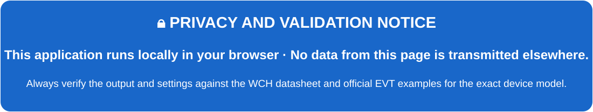

# MES-WCH-Configurator

  

  <a href="#نسخه-فارسی">🇮🇷 فارسی</a>　|　<a href="#english-version">🇬🇧 English</a>

**پیکربندی پریفراال‌های میکروکنترلرهای WCH و تولید کد راه‌اندازی C**

ابزار **WCH Configurator FA-EN v1.6** برای انتخاب خانواده و مدل میکروکنترلرهای WCH، تنظیم پریفراال‌های رایج و تولید کد اولیه راه‌اندازی به زبان C طراحی شده است.

> انتخاب تراشه، پیکربندی периферال‌ها و دریافت کد راه‌اندازی — در یک ابزار سبک تحت وب.

## اجرای آنلاین برنامه

  

**[▶ ورود به WCH Configurator v1.6](https://memar-electronic-sanat.github.io/MES-WCH-Configurator/)**

با کلیک روی لینک بالا، نسخه تحت وب برنامه مستقیماً در مرورگر باز می‌شود و نیازی به دانلود یا نصب ندارد.

## نسخه و فایل برنامه

- **نسخه:** 1.6
- **زبان رابط:** فارسی / English
- **اجرای آنلاین برنامه:** [WCH Configurator v1.6](https://memar-electronic-sanat.github.io/MES-WCH-Configurator/)
- **دریافت فایل HTML برنامه:** [WCH-Configurator-FA-EN-v1_6.html](./WCH-Configurator-FA-EN-v1_6.html)
- **مشاهده سورس HTML در GitHub:** [Source Code](https://github.com/MEMAR-ELECTRONIC-SANAT/MES-WCH-Configurator/blob/main/WCH-Configurator-FA-EN-v1_6.html)

  

## قابلیت‌ها

- انتخاب خانواده‌های پشتیبانی‌شده: CH32V، CH32F، CH32X، CH32L، CH57x، CH58x و CH59x
- انتخاب مدل میکروکنترلر از فهرست هر خانواده
- تنظیم GPIO، SPI، I²C، UART، TIMER، ADC و IRQ / EXTI
- نمایش نقشه منطقی پایه‌ها و پیکربندی‌های انتخاب‌شده
- تولید کد راه‌اندازی C متناسب با خانواده انتخاب‌شده
- کپی کد تولیدشده در کلیپ‌بورد و دریافت فایل .c
- رابط دو‌زبانه فارسی و انگلیسی
- بخش معرفی مجموعه **معمار الکترونیک صنعت**

  

## روش استفاده

1. روی دکمه **اجرای آنلاین** در بالای این صفحه کلیک کنید.
2. خانواده میکروکنترلر و سپس مدل دقیق تراشه را انتخاب کنید.
3. peripheral موردنظر را از بخش‌های GPIO، SPI، I²C، UART، TIMER، ADC یا IRQ پیکربندی کنید.
4. روی **Add to configuration** کلیک کنید تا تنظیم به فهرست پیکربندی اضافه شود.
5. نقشه پایه‌ها و کد تولیدشده را بررسی کنید.
6. با گزینه **Copy** کد را کپی یا با گزینه **Download .c** آن را دریافت کنید.
7. کد را در پروژه خود در MounRiver Studio یا محیط توسعه مناسب ادغام کنید.

## نکات مهم فنی

- کد تولیدشده، **کد اولیه راه‌اندازی** است و جایگزین بررسی دیتاشیت، Reference Manual و مثال‌های رسمی SDK/EVT نمی‌شود.
- پیش از استفاده واقعی، peripheral، پایه‌ها، قابلیت alternate function، کلاک، وقفه‌ها و محدودیت‌های پکیج را با دیتاشیت **مدل دقیق تراشه** تطبیق دهید.
- نقشه پایه‌ها در برنامه جنبه راهنمای منطقی دارد.

  

<table>
  <tr>
    <td bgcolor="#C62828" align="center">
      <h2>⚠️ هشدار مهم</h2>
      <h3>همه پایه‌ها در تمام پکیج‌ها در دسترس نیستند.</h3>
      پیش از طراحی PCB یا اتصال سخت‌افزار، تعداد پایه‌ها و قابلیت‌های قابل‌استفاده را در دیتاشیت پکیج دقیق میکروکنترلر بررسی کنید.
    </td>
  </tr>
</table>

- سبک کد بر اساس خانواده انتخاب‌شده تولید می‌شود. خانواده‌های CH32V/CH32F/CH32X/CH32L از الگوی کتابخانه‌های متناسب خود و خانواده‌های BLE سری CH57x/CH58x/CH59x از الگوی SDK مربوط استفاده می‌کنند.
- در برخی موارد، به‌ویژه peripheralهای چندگانه یا پیکربندی‌های خاص، لازم است کد تولیدشده را دستی تکمیل یا اصلاح کنید.
- پس از ادغام، پروژه را کامپایل و روی سخت‌افزار واقعی آزمایش کنید؛ خروجی برنامه تضمین‌کننده صحت الکتریکی یا سازگاری قطعی با تمام مدل‌ها نیست.

## منابع رسمی WCH

- [WCH — وب‌سایت رسمی](https://www.wch-ic.com/)
- [WCH Open Source — GitHub](https://github.com/openwch)
- [MounRiver Studio](https://www.mounriver.com/)
- [WCH Downloads / ابزارها و SDK](https://www.wch-ic.com/downloads)

## مخزن

[MEMAR-ELECTRONIC-SANAT / MES-WCH-Configurator](https://github.com/MEMAR-ELECTRONIC-SANAT/MES-WCH-Configurator)

  

  

# English Version

## Overview

**WCH Configurator FA-EN v1.6** is a bilingual web-based utility for selecting WCH microcontrollers, configuring common peripherals, and generating initial C-language initialization code.

It is intended to simplify the initial MCU configuration workflow and provide a practical starting point for embedded firmware projects.

## Launch the Web Application

  

  <strong><a href="https://memar-electronic-sanat.github.io/MES-WCH-Configurator/">▶ Launch WCH Configurator v1.6</a></strong>

The GitHub Pages entry point, index.html, automatically redirects to the v1.6 application. No download or installation is required to use the online version.

## Version and Project Files

- **Application version:** 1.6
- **Interface languages:** Persian / English
- **Live application:** [GitHub Pages](https://memar-electronic-sanat.github.io/MES-WCH-Configurator/)
- **GitHub Pages entry point:** [index.html](./index.html)
- **Main application file:** [WCH-Configurator-FA-EN-v1_6.html](./WCH-Configurator-FA-EN-v1_6.html)
- **Repository:** [MES-WCH-Configurator](https://github.com/MEMAR-ELECTRONIC-SANAT/MES-WCH-Configurator)

## Features

- Supports the CH32V, CH32F, CH32X, CH32L, CH57x, CH58x, and CH59x MCU families
- Select an MCU model from the corresponding family
- Configure GPIO, SPI, I²C, UART, TIMER, ADC, and IRQ / EXTI
- Display a logical pin map and selected configurations
- Generate initial C initialization code according to the selected family
- Copy generated code to the clipboard
- Download generated source code as a C file
- Bilingual Persian and English user interface
- Built-in help and an About section for MEMAR ELECTRONIC SANAT

## How to Use

1. Click the **Launch Web App** button above.
2. Select the required microcontroller family.
3. Choose the exact MCU model.
4. Configure the required peripheral using the GPIO, SPI, I²C, UART, TIMER, ADC, or IRQ sections.
5. Click **Add to configuration** to add the selected setting.
6. Review the logical pin map and generated source code.
7. Use **Copy** to copy the code or **Download .c** to save it.
8. Integrate the generated code into your project using MounRiver Studio or another suitable development environment.

## Technical Notes and Limitations

- The generated output is initial setup code. It is not a replacement for the device datasheet, Reference Manual, or official SDK/EVT examples.
- Verify pin assignments, alternate functions, clock settings, interrupts, and peripheral availability against the datasheet for the **exact MCU model and package**.
- The pin map is a logical reference and does not necessarily represent the physical availability of every pin in every package.
- Code-generation patterns depend on the selected family. CH32V/CH32F/CH32X/CH32L families use their corresponding library patterns, while BLE families CH57x/CH58x/CH59x use their respective SDK patterns.
- Some configurations may require manual code completion or modification.
- Compile the integrated project and test it on the actual target hardware.

  

<table>
  <tr>
    <td bgcolor="#C62828" align="center">
      <h2>⚠️ IMPORTANT WARNING</h2>
      <h3>Not all pins are available in every package.</h3>
      Before designing a PCB or connecting hardware, check the pin count and available functions in the datasheet for the exact microcontroller package.
    </td>
  </tr>
</table>

## Official WCH Resources

- [WCH Official Website](https://www.wch-ic.com/)
- [WCH Open Source — GitHub](https://github.com/openwch)
- [MounRiver Studio](https://www.mounriver.com/)
- [WCH Downloads — Tools and SDKs](https://www.wch-ic.com/downloads)

---

# تصاویر و دیاگرام‌های راهنما | Application Screenshots and Guide

در این بخش، تصاویر برنامه بر اساس زبان رابط کاربری در دو مجموعه مستقل ارائه شده‌اند.

This section contains two separate screenshot galleries, organized by the application interface language.

## تصاویر نسخه فارسی (FA)

  

### صفحه اصلی برنامه | Application Home Page

  

### تنظیم peripheralها | Peripheral Configuration

  

### راهنمای استفاده | User Guide

  

### درباره برنامه | About the Application

  

## English Version (EN)

  

### Application Home Page

  

### Peripheral Configuration

  

### User Guide

  

### About the Application

  

### تصاویر هویت بصری MES | Shared MES Visual Assets

  

  

  

## تهیه و تدوین

**معمار الکترونیک صنعت**
**MEMAR ELECTRONIC SANAT (MES)**

همراه شما در مسیر طراحی و ساخت مدارهای مطمئن

طراحی و توسعه مدارهای الکترونیکی، PCB، سیستم‌های embedded و ابزارهای پیکربندی میکروکنترلر.

- کانال تلگرام: [https://t.me/Memar_Electronic](https://t.me/Memar_Electronic)
- پیج اینستاگرام: [https://www.instagram.com/Memar.Electronic](https://www.instagram.com/Memar.Electronic)
- GitHub: [MEMAR-ELECTRONIC-SANAT](https://github.com/MEMAR-ELECTRONIC-SANAT)

---

  

  

